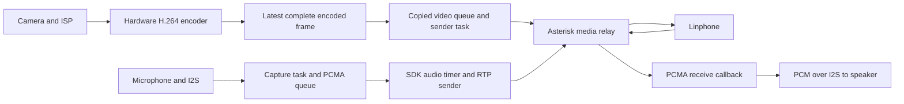

# Building and debugging the ESP32-P4 SIP video phone

Technical case study and worked study notes, 16 October 2026.

Read this alongside [the ordered learning path](LEARNING_PATH.md) and
[the original investigation record](LINPHONE_H264_DIAGNOSTICS.md).

## 1. Scope, evidence and current state

This guide describes the SIP/Linphone investigation recorded in this chat and
explains the surrounding architecture visible in the current source. Existing
camera, WiFi, RTSP and UI infrastructure is covered as prerequisite material;
its presence does not establish that every historical change to it happened
during this SIP investigation. README records an earlier unsuccessful GOP-15
experiment; that experiment is not the final SIP solution.

The original report also mentioned blank video with Linphone 5.0.2. The
detailed reproduction and final laptop acceptance used 5.2.6 after its codec
repair; we did not separately establish final compatibility with 5.0.2.

The final tested configuration is hardware H.264, 640×480, encoder configuration
30 fps, GOP 1, encoder target 3,000,000 bit/s, QP range 20–36, SIP transmit target
15 fps, and G.711 A-law mono speech at 8 kHz. Configured rates are targets, not
measurements of what reaches the screen.

The application sends its camera; it does not decode remote video for display.
Audio has transmit and receive paths. Board → laptop audio and video were
confirmed working after the fixes. The user subsequently confirmed smartphone
Linphone → board speaker playback. A scream during laptop → board testing was
therefore isolated to the laptop endpoint/test setup; its exact configuration
fault was not diagnosed. Acoustic feedback was a hypothesis, not a proven cause.

The user has since commented out the body of `_send_audio` in
`main/VoIP_manip.c`, leaving a return of zero for speaker-only testing. This
source change disables outgoing microphone media. The capture task still
starts on the audio-session event. The verified backup predates that change.

The saved accepted application is `backups/sip-av-verified/internship.bin`, with
its sdkconfig and checksum. Temporary captures and extracted libraries under
`/tmp` are diagnostic artifacts and can disappear after reboot. They are not
required runtime dependencies of the firmware.

## 2. Draw the system before debugging it

The tested addresses were board `10.192.65.235`, computer/Asterisk
`10.192.65.165`, board extension 103 and Linphone extension 101. These are
observed test values, not permanent project requirements.



There are separate control and media paths. SIP establishes and ends sessions.
SDP inside signaling describes media addresses and formats. RTP carries audio
and video. RTCP carries media reports. A successful SIP call does not prove
that a camera frame was encoded, transported, decoded or displayed.
See [SIP RFC 3261](https://www.rfc-editor.org/rfc/rfc3261),
[SDP RFC 8866](https://www.rfc-editor.org/rfc/rfc8866), and
[RTP/RTCP RFC 3550](https://www.rfc-editor.org/rfc/rfc3550).

Asterisk created two media legs in the observed test. It could change RTP
payload identifiers without changing the encoded H.264 bytes. Comparing only
IP addresses, packet headers or whole-packet hashes would miss this distinction.

## 3. Challenge one: H.264 could not stay enabled in Linphone 5.2.6

### Observation and diagnosis

The immediate symptom looked like missing codec support. Inspection showed a
more specific failure: the AppImage's media plugin expected OpenH264 ABI 6,
while its download mechanism supplied OpenH264 2.4.1 with SONAME 7. The codec
family was supported by the plugin, but its required implementation could not
load compatibly. The failure is also reported in the project's
[upstream issue 729](https://github.com/BelledonneCommunications/linphone-desktop/issues/729).

Distinguish three identifiers:

| Identifier | Meaning in this case |
| --- | --- |
| H.264 | Compressed video format understood by peers |
| OpenH264 2.2.0 or 2.4.1 | Particular software implementation/release |
| `libopenh264.so.6` or `.7` | Shared-library ABI identity expected by a loader/plugin |

A filename is not an ABI conversion. Renaming an incompatible `.so.7` file to
`.so.6` does not change class layouts, interfaces, symbols or calling contracts.

### Solution and validation

1. Inspect the AppImage's actual `libmsopenh264.so` dependency.
2. Obtain Cisco's ABI-6 OpenH264 2.2.0 binary.
3. Verify the exact uncompressed binary hash before installing it.
4. Back up the previous codec and replace the per-user library atomically.
5. Keep Linphone 5.2.6's expected `H264.txt` marker so this version does not
   immediately download the incompatible binary again.
6. Restart Linphone, enable H264 and verify the saved setting.
7. Instantiate the actual media plugin's encoder and decoder, then negotiate
   H.264 in a call. Merely finding a library file is weaker evidence.

`tools/repair_linphone_526_h264.py` automates the checked install. It expects
the downloaded `.bz2` file, decompresses it, checks SHA-256, backs up changed
files, writes a temporary file in the destination directory and replaces the
target. That same-directory replacement avoids leaving a partially written
library at the normal path if an operation is interrupted.

This workaround is specific to the tested Linux 5.2.6 package. Reassess it
before applying it to another release or CPU architecture.

## 4. Challenge two: the call connected but video stayed blank

We separated delivery, timing and decoding instead of treating “blank video”
as one failure.

### Step 1: inspect negotiation

The board offered H264/90000, packetization-mode 1 and sendonly. Asterisk
accepted video with a nonzero media port. The board entered its video session
and supplied frames containing SPS, PPS and IDR units.

The project also contains an SDP compatibility wrapper in
`main/rtsp_sdp_compat.c`. Its exact-template matches add packetization-mode 1
to the prebuilt stack's H.264 descriptions, and sendonly to its SIP template.
This matters because the stack packetizes large NALs using FU-A. Signaling
must describe the packetization actually used. The wrapper preserves formatted
lengths so the SIP Content-Length remains correct. It leaves unrelated format
strings alone. Read [RFC 6184](https://www.rfc-editor.org/rfc/rfc6184) for the
H.264 RTP payload definitions.

### Step 2: capture both media legs

The first capture filter saw the board → Asterisk traffic but missed the
Asterisk → Linphone traffic addressed from the computer to its own LAN address.
Loopback traffic need not use a 127.x address. Capture coverage must follow the
actual addresses and routes.

The second capture included that self-addressed path. It contained 1,932 board
video RTP packets and 211 reconstructed complete pictures over about 39.2 s.
The reconstructed Annex B streams on both sides of Asterisk were byte identical.
Payload type changed from 96 to 97; the video bytes did not.

### Step 3: test a decoder independently

FFmpeg decoded all 211 pictures without reported errors, at 640×480 Constrained
Baseline. A decoded picture showed camera imagery. That ruled out several
simple explanations for this sample: no camera output, wholesale delivery
failure, and an entirely undecodable reconstructed stream.

It did not establish compatibility with Linphone's exact decoding API.

### Step 4: investigate a second, independent timing fault

Video RTP time advanced only 18.467 seconds while wall time advanced 39.2 s:

```text
media time / wall time = 18.467 / 39.2 ≈ 0.471
```

Linphone's adaptive estimator separately reported a ratio around 0.52. These
are different measurements over different windows; neither should be relabeled
as the other. Both indicated a badly slow sender media clock.

The SDK added one nominal interval per executed callback. When callbacks were
delayed or could not maintain the intended rate, media time failed to follow
elapsed time. `main/sip_rtp_clock.c` supplies timestamps from a shared monotonic
call epoch for identified SIP buffers. The timing-only firmware improved the
clock estimate, but video remained blank. This was a partial fix, not the whole
diagnosis.

### Step 5: reproduce Linphone's decoder behavior

`tools/check_openh264_compat.cpp` exercised the installed Cisco 2.2.0 decoder
with the captured stream:

| Input/API | Input pictures | Output pictures | Reported errors |
| --- | ---: | ---: | ---: |
| Original, `DecodeFrame2` | 211 | 0 | 0 |
| Original, `DecodeFrameNoDelay` | 211 | 211 | 0 |
| AUD before each picture, `DecodeFrame2` | 211 | 210 | 0 |

The critical result was zero output **without an error**. An error-free API
return did not mean a picture had been produced. GOP-1 hardware output repeated
picture identifiers (`frame_num`, `idr_pic_id`, with the observed POC setup),
and this API path did not finish pictures as expected without explicit boundaries.

### Step 6: supply an explicit access-unit boundary

The SIP callback now prepends:

```text
00 00 00 01 09 F0
```

The first four bytes are an Annex B start code. `09` has NAL type 9, an Access
Unit Delimiter. `F0` carries primary_pic_type 7 followed by the RBSP stop bit
and alignment zeros. This is a six-byte addition to each SIP picture.

The callback reserves six bytes before copying, then writes the delimiter.
It does not shift beyond the SDK destination capacity or edit a camera buffer
that an RTSP reader may be using. The actual live test then showed video.

The 210/211 offline count reflects the observed one-picture buffering behavior
of that test path. It is not evidence that one picture per 211 is lost in RTP.

### What this teaches

“A decoder can decode this file” and “this application's streaming decoder
produces pictures” are separate claims. Delivery, timestamp correctness,
bitstream syntax and API buffering semantics each need evidence.

## 5. Challenge three: speech gaps that looked like packet loss

### Count the media represented by the packets

One call lasted about 35.5 s but delivered only 1,134 PCMA packets. Each carried
160 audio samples. The represented duration was:

```text
samples received = 1,134 × 160 = 181,440
audio duration   = 181,440 / 8,000 = 22.68 s
missing duration relative to the call ≈ 12.82 s
```

Linphone reported no lost, late, malformed or queue-overflow packets in that
sample. The sender had not supplied enough audio. A receiver detects sequence
gaps among transmitted packets; it cannot count an audio chunk the sender never
packetized as an ordinary network-lost RTP packet.

### Identify the execution context

The SDK's audio and video send callbacks execute through the shared ESP timer
task. The old audio callback performed a blocking microphone read representing
20 ms of sound. A timer callback must also leave time for the other callbacks.
The [ESP timer documentation](https://docs.espressif.com/projects/esp-idf/en/v5.5/esp32p4/api-reference/system/esp_timer.html)
explains why long task-dispatched callbacks delay other callbacks.

For a simplified shared executor, the demand is:

```text
U = audio_callbacks_per_second × audio_callback_cost
  + video_callbacks_per_second × video_callback_cost
  + other callback work
```

If 50 audio callbacks each wait roughly 20 ms, that alone consumes roughly
1 second of executor occupancy per second. This is an occupancy argument,
not necessarily 100% CPU arithmetic usage: a task blocked on I/O still cannot
execute the next callback in that task. Adding video work makes deadlines fail.
Average utilization below one is also insufficient if individual stalls exceed
the audio deadlines.

### First solution: separate microphone capture

`main/sip_audio_capture.c` creates `sip_mic`, priority 6, with a 4,096-byte
task stack. It reads stereo PCM, selects one channel, encodes PCMA and places
160-byte chunks into a bounded queue. The SDK callback takes available data
without waiting for I2S.

Its important contracts are:

| Contract | Implementation reason |
| --- | --- |
| One chunk is 160 samples | Exactly 20 ms at 8 kHz |
| Queue holds 12 chunks | At most 240 ms of whole-chunk queued media |
| Overflow discards oldest | Bound stale speech latency instead of letting it grow |
| Each chunk has a timestamp | Delayed delivery must not erase sample spacing |
| Each chunk has a generation | Previous-call samples must not enter a new call |
| Partial-read cursor is retained | A small requested buffer must not discard the rest of a chunk |

The timestamp sequence advances 20,000 microseconds per captured chunk. The
first timestamp is anchored at the first successful read completion. It is a
practical sample timeline, not a hardware timestamp for every ADC conversion.
Partial reads advance by 125 microseconds per sample. A read error invalidates
the local time anchor so the next valid chunk can re-anchor.

The user reported improvement, but remaining gaps. Instrumentation then showed
about 50 captured chunks per second while the queue overflowed. One 2,052 ms
interval captured 103 chunks, supplied 7,200 samples and dropped 67 chunks.
The microphone was now producing enough samples; its consumer was still delayed.

### Second solution: remove video network sends from the timer task

`main/sip_video_tx.c` owns two aligned PSRAM frame slots and a dedicated sender
task. The timer path copies a complete encoded picture into an available slot
and queues the slot index. The worker performs the SDK RTP send. If both slots
are occupied, the timer path drops a complete intra picture and returns.

The copy is essential: the SDK reuses its source buffer after its callback
returns. Enqueuing that source pointer would let the producer overwrite a
picture while the sender is packetizing it. A queue makes pointer delivery
ordered; it does not automatically extend the pointed-to object's lifetime.

After this change, the user confirmed good audio. Logs showed approximately
8,000 supplied samples/s, with no microphone queue drops or I2S read errors.

### Make hangup safe

Moving work to another task changes resource lifetime. When the SDK destroys
an RTP handle, a queued worker must no longer use it. The `esp_rtp_stop` wrapper
disables acceptance and waits for pending copied/in-flight sends to finish
before forwarding to the real stop function.

The required ordering is:

```text
stop accepting → finish existing users → destroy transport
```

Waiting while holding the spinlock would prevent the worker from updating the
pending count and could deadlock. The implementation checks under the lock,
releases it, and waits on a semaphore outside the critical section.

## 6. Challenge four: audio was good but video was slow and blocky

### Scheduling and lock contention

The first video sender used priority 5. Inspection of the pinned SDK binary
showed a priority-15 video receiver and a shared per-handle RTP mutex. The
receiver could hold that mutex while waiting up to 200 ms for incoming media.
The application discards incoming video, but this receive path still existed.

Moving sends off the timer protected audio; it did not remove that shared lock
or guarantee fair access to it. Linphone decoded only roughly 2–6 fps through
much of the recorded call.

The final adjustment raised the sender to priority 16 and capped receive polls
at 10 ms for the identified SIP video handle. Audio and unrelated RTP handles
retain their original behavior. The higher sender priority helps it run when
the receiver releases the mutex; the shorter wait bounds an unnecessary lock
hold. Priority inheritance alone cannot make a socket wait disappear.

This receive adjustment is appropriate to the current application, which does
not display remote video. Revisit it if remote-video decoding is implemented:
receive polling, partial-frame assembly and scheduling then require new tests.

### Correct a diagnostic mistake

The first worker counted `ret == ESP_OK` as send success. The SDK send function
actually returns the last UDP write's byte count on success. Positive counts
were mislabeled as errors. This did not itself stop transmission, but it made
the counters misleading.

The final code accepts nonnegative send results while separately treating ESP
cache-sync errors as failures. ESP error codes can be positive: a blanket
`ret >= 0` check is not valid for every API. The SDK return is also only its
last-write result; packet captures are stronger evidence of complete delivery.

### Picture compression

The encoder target increased from 1.5 to 3 Mbit/s, and maximum QP decreased
from 40 to 36. QP controls quantization strength; heavier quantization discards
more coefficient precision. Giving each intra picture more bits and limiting
coarse quantization can preserve detail. It does not fix focus, sensor noise,
resolution limits or packet timing.

For a rough budget, assuming the encoder meets its configured 30 fps and
average bitrate:

```text
old budget = 1,500,000 / 30 / 8 = 6,250 bytes/picture
new budget = 3,000,000 / 30 / 8 = 12,500 bytes/picture
```

If SIP selected exactly half the encoded pictures with similar average sizes,
the new payload rate would be about 1.5 Mbit/s. Real sizes and selected pictures
vary, so this is a budget calculation, not a throughput claim.

### Acceptance evidence

The accepted live test had sender intervals near 15 pictures/s, zero video
queue drops/send errors in the sample, and stable audio. Sampled Linphone
decoder rates were 13.75, 13.95, 15.16 and 9.09 fps; video clock estimates
settled near 1.000. Both media streams reported zero lost or late packets at
hangup. Camera-publisher contention still caused some lower-frame-rate
intervals. The user confirmed that audio and image quality worked well.

## 7. Challenge five: a scream during board-speaker testing

The user disabled outgoing microphone media by changing `_send_audio` to return
zero. The receive callback still decoded A-law bytes to signed 16-bit samples,
duplicated mono samples to both I2S slots, and wrote them to the codec.

We considered endpoint feedback/configuration and a board playback fault.
Disabling board microphone transmission does not disable the laptop's
microphone, nor exclude an acoustic path from the board speaker back to that
laptop microphone. However, no mute-test result established that mechanism.

The decisive later observation was that smartphone Linphone played proper
speech through the board speaker. The user identified the laptop configuration
as the issue. No receiver firmware patch was made for this symptom. A controlled
endpoint substitution can be more informative than changing correct firmware.

Separate three future features: mute/disable for testing, half-duplex operation,
and acoustic echo cancellation for simultaneous conversation. They solve
different problems. This project has not established full-duplex acoustic echo
cancellation merely because both audio directions work separately.

## 8. Timing, packets and queues: worked technical foundations

### 8.1 Audio sizes and units

At 8,000 samples/s, one sample period is 1/8,000 s = 125 microseconds.
For 20 ms chunks, N = 8,000 × 0.020 = 160 samples. The board reads two 16-bit
I2S slots, so a chunk is 160 × 2 × 2 = 640 PCM bytes. It selects one channel
and encodes each sample as one A-law byte, producing 160 media bytes.

The rates are 256 kbit/s for those raw stereo PCM slots and 64 kbit/s for the
mono PCMA payload. With minimal IPv4 (20 B), UDP (8 B) and RTP (12 B) headers,
each 160-byte packet occupies 200 bytes at the IP layer. Fifty packets/s then
consume 80 kbit/s, before link-layer overhead and RTCP. These calculations
explain why payload bitrate and measured WiFi traffic differ. PCMA/PCMU RTP
profile mappings are defined in [RFC 3551](https://www.rfc-editor.org/rfc/rfc3551).

Sampling, quantization and companding are separate operations. Sampling chooses
time instants; PCM quantization chooses numerical amplitudes; A-law maps a
wider linear amplitude representation to a compact nonlinear code. A-law
does not reduce the sampling rate to 4 kHz. See [ITU-T G.711](https://www.itu.int/rec/T-REC-G.711).

The receive callback's stereo duplication does not manufacture spatial audio.
It supplies the same mono value to both configured hardware slots. Never
infer mono/stereo memory layout from the number of physical speakers alone.

### 8.2 RTP fields that answer different questions

An ordinary RTP header includes a payload type, sequence number, timestamp and
SSRC. Sequence numbers identify packet progression; timestamps identify media
time; an SSRC identifies a synchronization source within an RTP session.
A 90 kHz H.264 clock does not mean 90,000 pictures/s.

For this project, nominal 15 fps gives 90,000/15 = 6,000 video timestamp ticks
per evenly spaced picture; a 20 ms 8 kHz audio packet spans 160 ticks. All
fragments belonging to one picture need the appropriate common picture time.
The H.264 marker bit identifies the end of an access unit, not every NAL.
Details: [RTP](https://www.rfc-editor.org/rfc/rfc3550),
[H.264 payloads](https://www.rfc-editor.org/rfc/rfc6184).

Our private SDK send ABI accepts microseconds. Its packetizer converts them
into the relevant media clock. Supplying 90 kHz ticks directly to this API
would be a units bug. `sip_rtp_clock.c` sends elapsed microseconds:

```text
elapsed_us = selected_media_time_us - call_epoch_us
expected wire ticks = base_ticks + floor(elapsed_us × clock_hz / 1,000,000)
```

The second expression describes the intended units; the SDK's exact integer
rounding implementation can differ. Use 64-bit intermediates for products.
Unsigned modular subtraction handles timestamp wrap for sufficiently short
measurement intervals. At 90 kHz, a 32-bit timestamp wraps after about
47,721.9 seconds, or 13.26 hours. A random/nonzero initial timestamp is valid;
debugging usually needs differences, not an assumed absolute zero.

Capture time and send time differ when audio is queued. Suppose five chunks
captured at 0, 20, 40, 60 and 80 ms are sent in a burst near 100 ms. Timestamping
all five at the send instant destroys their spacing. Retaining the capture
sequence preserves their 20 ms relationships, although delivery jitter remains.

A shared monotonic epoch makes the application's time units consistent. It
does not alone guarantee precise lip synchronization: source capture offsets,
hardware-clock drift, RTCP mappings and receiver playout behavior also matter.

### 8.3 Queue conservation and latency

For a queue measured in chunks:

```text
Q_next = Q_now + produced - consumed - discarded
```

Use the same interval, account for a partially consumed chunk and ignore/reset
startup counters deliberately. A finite queue can absorb a finite burst. It
cannot permanently fix a consumer whose average service rate is below the
producer rate. At 50 input chunks/s and 35 consumed chunks/s, a 12-slot queue
fills from empty in about 12/(50-35) = 0.8 s.

Keeping old frames forever would trade a visible drop for growing conversation
delay. The audio queue discards oldest data to recover freshness. The video
queue discards new whole pictures when its two owned slots are full. These
are explicit policies with different latency/freshness tradeoffs.

For this GOP-1 video path, a later picture can decode independently. Changing
to inter prediction invalidates the assumption that arbitrary picture drops
are harmless: a missing reference can affect later pictures. That is why
“increase GOP for better compression” is not an isolated safe tuning change.

## 9. Memory ownership, DMA and caches

### 9.1 A pointer is an address, not an ownership contract

For each buffer, write down its allocator, current writer, allowed readers,
capacity, valid length, cache state, reuse point and destructor. Do this for
raw camera buffers, encoded publication buffers, SDK callback buffers, queued
copies, audio stack arrays and display strips.

In `main/frame_pool.h`, a raw camera buffer progresses through:

```text
FREE → CAPTURING → READY → PROCESSING → FREE
```

Capture may claim only FREE buffers. The encoder claims the current READY
buffer and protects it as PROCESSING. A new completed capture can replace an
older READY frame, but cannot reclaim the encoder's PROCESSING frame. The
camera driver can request another transaction before reporting the previous
one complete; assuming those callbacks alternate in a simple order is unsafe.

The encoded publisher has a different ownership protocol. Its mutex protects
the shared bytes, length and sequence. Each consumer uses its own sequence
cursor, so SIP cannot consume a frame on behalf of RTSP. A busy publisher
causes a nonblocking SIP read to skip that opportunity instead of waiting in
the shared timer task.

An SDK callback buffer is different again: after the call returns, the SDK
can reuse it. The video worker therefore owns a copy. Passing a queue element
containing a pointer copies the pointer value; it does not copy the picture.

### 9.2 Cache state is separate from logical ownership

DMA and CPU accesses can observe different copies of a memory region on this
platform. CPU writes may still reside in cache; DMA writes may leave cached
CPU data stale. C2M synchronization publishes CPU-written bytes toward memory;
M2C synchronization refreshes the CPU view of memory-written bytes. Consult
the platform's [memory synchronization documentation](https://docs.espressif.com/projects/esp-idf/en/v5.5/esp32p4/api-reference/system/mm_sync.html).

The project's handoffs include:

```text
camera DMA completes → refresh raw input view → encoder uses input
CPU copies encoded bytes → write back publication → reader refreshes and copies
CPU fills queued video slot → write back → worker refreshes → RTP packetizer
```

The slots are 64-byte aligned and synchronization lengths are rounded to
cache-line boundaries. Rounding a length is safe only if the allocation covers
the rounded region. Independently owned objects should not share lines that
one owner invalidates while another has dirty data. A mutex protects access
ordering; it is not a replacement for peripheral/cache visibility operations.

### 9.3 C concurrency primitives serve different purposes

`volatile` does not make a read-modify-write operation atomic and does not
define ownership or inter-task synchronization. Atomic flags/counters provide
defined concurrent accesses. A mutex permits blocking ownership of a resource.
A spinlock/critical section protects very short shared-state updates. A queue
transfers bounded items; a semaphore or task notification signals progress.

Do not hold a spinlock over I2S, a socket operation, a decoder, a semaphore wait
or a large image copy. In this code the spinlock protects metadata, while
ownership of a selected video slot permits copying outside that lock.

The host tests deliberately simulate important schedules, but ordinary fake
locks do not prove real multicore memory ordering or cache correctness.

### 9.4 Calculate memory before tuning resolution

For 640×480 8-bit YUV 4:2:0 storage, the size is:

```text
Y plane       = 640 × 480       = 307,200 bytes
two chroma planes together     = 153,600 bytes
total                          = 460,800 bytes
three raw buffers              = 1,382,400 bytes
two 640 KiB video slots        = 1,310,720 bytes
```

These are storage budgets, excluding encoder scratch memory, SDK buffers,
display buffers, stacks and queue metadata. The hardware's packed
`O_UYY_E_VYY` format must follow its SDK contract; equal bytes-per-picture does
not mean the memory can be treated as ordinary planar I420.

At 1280×720, 4:2:0 storage would be 1,382,400 bytes per picture: three times
VGA. Changing dimensions also affects sensor output, ISP, encoder allocation,
SDP, copy limits, processing time and bandwidth. Editing only a width macro is
not a complete resolution change.

## 10. Working with prebuilt libraries and ABI boundaries

The project uses `esp_media_protocols` 0.6.1. Some functions we needed to
intercept were available only through its prebuilt archive. The function
names alone did not tell us parameter types, units, structure layouts or return
semantics.

We inspected ELF archive members, DWARF type information and RISC-V disassembly.
For example, the pinned send ABI is:

```c
int esp_rtp_send(void *rtp, uint8_t *payload,
                 uint32_t length, uint64_t timestamp_us);
```

The 64-bit timestamp is significant on a 32-bit machine. An incorrect
declaration can place arguments in the wrong registers or use the wrong width,
even if linking succeeds. DWARF helps reconstruct types; disassembly reveals
conversions, lock calls and transport behavior. Neither replaces functional
validation. See [RISC-V ABI](https://riscv-non-isa.github.io/riscv-elf-psabi-doc/)
and [GNU readelf](https://sourceware.org/binutils/docs/binutils/readelf.html).

GNU link wrapping redirects unresolved references to a symbol toward
`__wrap_symbol`; the wrapper can call `__real_symbol` to reach the original.
It is a link-time facility with limits, including how references are resolved
inside translation units. It is not a promise to intercept every possible
internal call. We checked the final link map for the actual calling objects.
See [GNU ld options](https://sourceware.org/binutils/docs/ld/Options.html).

The project's wrappers are narrowly scoped by known buffers/handles or exact
format strings. This avoids changing unrelated RTSP or audio calls. SDK
upgrades require checking those assumptions again.

The two SDK distributions also expose differing configuration layouts. The
build rejects `CONFIG_MEDIA_PROTOCOL_LIB_ENABLE` when it would enable ADF's
competing media-protocol copy. Headers, libraries and configuration structures
must belong to a compatible component version. A successful C compilation
against one header cannot validate a differently laid-out prebuilt callee.

Variadic formatting adds another contract: consuming a `va_list` changes its
state. The allocating SDP wrapper uses `va_copy` for the counting pass, allocates
length+1 with the library allocator, then performs the write pass. Mixing
allocation/deallocation families or returning a stale formatted length can
break a caller even when the SDP text looks correct in a log.

## 11. H.264 concepts to understand at the byte level

Follow the distinction between a picture, a slice, a NAL unit, an access unit,
an RTP packet and a UDP datagram. Their boundaries are not generally identical.
One picture may require multiple slices, NALs and RTP packets.

For a NAL header byte `h`, `h & 0x1f` gives the NAL type. Relevant types observed
here are 7 (SPS), 8 (PPS), 5 (IDR slice) and 9 (AUD). SPS/PPS carry parameters
that slices depend on; they are not picture pixels. An IDR establishes a random
access point with reference-picture reset semantics. A generic intra picture
and an IDR picture are not interchangeable definitions.

Annex B places start-code prefixes before NALs. Other storage formats use
length prefixes. A parser cannot assume that every zero sequence is a picture
boundary, or that a captured RTP payload contains Annex B start codes.
The [H.264 standard](https://www.itu.int/rec/T-REC-H.264) is the normative
reference for bitstream syntax and decoding semantics.

For a large NAL fragmented as FU-A, reconstruct the original header from the
FU indicator's high bits and FU header's low five bits:

```c
uint8_t original_nal_header = (fu_indicator & 0xe0) | (fu_header & 0x1f);
```

For example, indicator `7c` and start header `85` reconstruct `65`, an IDR NAL
header. Append fragment bodies in sequence order after that reconstructed
header. Check start/end flags, sequence continuity and common timestamp before
declaring a whole NAL complete. This worked reconstruction, rather than a
whole-packet hash, let us compare media across Asterisk's header translation.

To go deeper, learn RBSP versus escaped byte-stream payload, emulation-prevention
bytes, Exp-Golomb codes, SPS picture dimensions/cropping, PPS references, slice
headers and first-VCL-picture detection. The AUD patch addresses an observed
decoder compatibility boundary; it is not a general-purpose repair for an
arbitrary malformed H.264 stream.

Compression requires learning prediction, residuals, transform coefficients,
quantization, entropy coding and reference-picture storage. GOP 1 avoids
inter-picture dependencies at a substantial bitrate cost. Inter prediction can
reduce bits but makes reference delivery and recovery central design concerns.
The earlier GOP-15 experiment in the repository was rolled back after its
performance acceptance failed; its existence is not evidence it improves this
accepted firmware.

## 12. Supporting hardware and application concepts

These are part of understanding the project even though they were not all the
faults diagnosed in this SIP session.

### 12.1 Sensor, ISP and encoder

The OV02C10 sensor is configured through I2C; its picture data enters the MIPI
CSI/ISP path. Sensor configuration traffic and picture payload traffic are
different buses. The ISP has demosaic, white-balance statistics, color matrix
and gamma-related configuration in `main/camera_manip.c`. Study exposure and
gain before assuming every soft/noisy picture is a compression problem.

For a Bayer source, demosaicing estimates missing color components at each
location. White balance adjusts channel relationships; a color matrix mixes
channels; gamma changes the code-value response. Chroma subsampling reduces
color detail relative to luma. These operations can affect color and detail
before H.264 sees a picture. Inspect the actual sensor/ISP configuration rather
than assuming every possible ISP stage is enabled. Official references:
[camera controller](https://docs.espressif.com/projects/esp-idf/en/v5.5/esp32p4/api-reference/peripherals/camera_driver.html),
[ISP](https://docs.espressif.com/projects/esp-idf/en/v5.5/esp32p4/api-reference/peripherals/isp.html).

### 12.2 ES8311, I2S and I2C

The codec's control interface uses I2C; audio samples use I2S. MCLK is a codec
clock, BCLK clocks serial sample bits, and WS/LRCLK marks slots/frames. In this
project, 8 kHz with two 16-bit slots implies nominal BCLK 256 kHz, and the
configured MCLK multiple 256 implies MCLK 2.048 MHz. Verify actual clocks when
debugging hardware; configuration arithmetic alone is not a scope measurement.
See [ESP-IDF I2S](https://docs.espressif.com/projects/esp-idf/en/v5.5/esp32p4/api-reference/peripherals/i2s.html).

Distinguish sample width, slot width, channel mask, byte order, signed PCM,
amplifier gain and DAC volume. The current startup sets output volume to 100
and microphone gain to 20 dB through the codec API. These settings are unrelated
to H.264 QP or PCMA sample rate. Duplex echo cancellation would require a
playback reference, delay alignment and an adaptive filter; mute controls do
not implement it.

### 12.3 Hosted WiFi and asynchronous state

`main/WIFI_manip.c` initializes the hosted connection to the ESP32-C6 WiFi
coprocessor and then the network stack. Link association, obtaining an IP
address and SIP registration are separate states. Its event-driven request
handling waits for disconnect acknowledgement before applying replacement
credentials and keeps the newest requested network configuration.

This is a general lesson in asynchronous API design: a function returning
success for “disconnect requested” does not mean the disconnect event has
already occurred. A late event must be interpreted against current desired
state. Similarly, registered, ringing, answered and media-active are distinct
SIP/UI states.

### 12.4 LVGL, LCD and touch

The current UI renders partial RGB888 strips and rotates them for LCD transfer.
If a strip has width W and height H, a clockwise rotation maps source local
coordinates `(x,y)` to destination `(H-1-y,x)`. Row stride can include padding;
do not assume it is always W×3. The rotated buffer must stay valid until the
LCD transfer-completion callback calls `lv_display_flush_ready`.

Touch coordinates must use the corresponding display orientation. Network
callbacks update state; UI updates run with the LVGL locking/thread model.
This prevents a slow service operation from creating a lock cycle with a
callback that also tries to manipulate widgets. Inspect `main/LVGL_manip.c`
and `main/UI_engine.c` for these lifetimes and execution contexts.

### 12.5 RTSP and why it remains useful

The project also has an RTSP path, separate from SIP call signaling. DESCRIBE
obtains a session description, SETUP establishes transport and PLAY starts
delivery in a typical RTSP/1.0 session. RTP media can use UDP or TCP interleaving.
RTSP success is a useful partial camera/network test, but does not prove
Linphone's SIP negotiation or decoder path. The older implementation family
uses concepts in [RTSP/1.0 RFC 2326](https://www.rfc-editor.org/rfc/rfc2326);
RTSP/2.0 is separately specified by RFC 7826. Do not assume identical protocol
behavior just because both versions are called RTSP.

## 13. A repeatable investigation procedure

Use this sequence for the next failure. It avoids changing every layer at once.

1. **Freeze the starting point.** Record source changes, sdkconfig, dependency
   lock, SDK path/version, application hash, hardware and endpoint versions.
   Keep an application recovery image. Current source and a saved accepted
   image can differ; the user's disabled microphone is an example.
2. **State the failure precisely.** Include direction, whether registration
   succeeds, whether the call is answered, whether media starts, and whether
   the symptom is no output, corruption, low frame rate or delayed output.
3. **Inspect the control plane.** Read the actual offer and answer. Match
   addresses, ports, codecs, clock rates, format parameters and directions.
   SDP syntax alone does not determine which offer/answer combination is valid;
   read [RFC 3264](https://www.rfc-editor.org/rfc/rfc3264).
4. **Observe production at the source.** Count successful captures, complete
   encoded frames and callback supply, using actual interval durations.
5. **Capture both media legs.** Follow actual routing, including self-addressed
   local traffic. Separate sessions by endpoints, SSRC and payload mapping.
6. **Reconstruct and inspect.** Validate packet lengths, sequence continuity,
   timestamps and fragmentation. Hash reconstructed encoded data when comparing
   a relay's input and output.
7. **Measure time independently.** Compare timestamp deltas with elapsed capture
   time, and samples represented with call duration. Avoid confusing counts,
   rates and cumulative counters.
8. **Reproduce downstream consumption offline.** Feed the exact decoder and
   relevant API path. Count output pictures separately from return errors.
9. **Change the smallest responsible contract.** State what the change should
   alter and which measurement would falsify the diagnosis.
10. **Verify at several levels.** Host logic tests, target build, link-map
    inspection, flash verification, live counters and human perception answer
    different questions. Save the accepted version and its known limits.

An example capture command used during the investigation was:

```sh
sudo timeout 40 tcpdump -i any -s 0 -w /tmp/board-sip-video-both.pcap \
  'udp and (host 10.192.65.235 or (src host 10.192.65.165 and dst host 10.192.65.165) or net 127.0.0.0/8)'
```

Adapt the addresses to the current network. This filter was designed for this
UDP/LAN test and is not a generic capture rule for all SIP transports or NAT
topologies. PCAP link-layer type matters: Linux cooked capture is not always
Ethernet with a 14-byte header. A parser that blindly skips 14 bytes can invent
packet-format failures. Wireshark's
[telephony tools](https://www.wireshark.org/docs/wsug_html_chunked/ChTelephony.html)
are useful for correlating signaling and media.

### Host checks and what they prove

```sh
python3 tests/run_host_tests.py --cc gcc
python3 tests/run_sip_rtp_clock_test.py
python3 tests/run_sip_audio_capture_test.py
python3 tests/run_sip_video_tx_test.py
```

These passed for the accepted duplex source before the user's later TX-disable
edit. The general host test expects `_send_audio` to supply media; it is expected
to disagree with an intentionally disabled callback. Do not silently restore
the microphone just to make that test pass during a speaker-only experiment.

The tests compile production logic with fake boundaries. They cover frame-pool
ownership schedules, state transitions, SDP formatting, delayed clocks, call
generation changes, queue overflow, partial reads, reused source buffers,
drain-before-free behavior and return-value conventions. They do not prove
sensor electrical timing, actual cache/DMA behavior, network performance,
acoustic behavior or the correctness of every prebuilt library path.

### Build and flash facts

This machine uses ESP-IDF from the ESP-ADF installation and sets `ADF_PATH`.
The firmware target is `esp32p4`; the project pins media protocols to 0.6.1.
The component resolver can access a registry even for a CMake regeneration.
Keep the actual resolved versions, not just manifest version ranges, when
reproducing a build. Local dependency paths also need to be recorded.

The accepted application was flashed at `0x10000` only. Its SHA-256 is:

```text
1750e136a66ae84879031021840836b5452d02a4bbc5dc8bc593748b09050840
```

Application-only flashing preserved the bootloader, partition table and NVS.
The app's WiFi/SIP credentials are held in RAM, so they still needed reentry
after restart. Preserving NVS does not imply every setting was stored there.
Do not infer an application's flash offset from another board's example;
check this project's partition table and generated flash arguments.

## 14. Source reading map

All paths below are relative to the project root
`/home/haami/codes/C_codes/idf_projects/test_22_07`.

| File | Read it to answer |
| --- | --- |
| `main/internship.c` | What initializes first, and which resources must exist before others? |
| `main/idf_component.yml`, `main/CMakeLists.txt` | Which implementation owns each API, and where are wrappers linked? |
| `main/Kconfig.projbuild`, `sdkconfig` | Which settings are defaults and which are actually selected? |
| `main/WIFI_manip.c` | How do requests, events and connection state interact? |
| `main/audio_manip.c` | What are the codec pins, clocks, sample format and gain settings? |
| `main/frame_pool.h` | Who owns each raw camera buffer at each transition? |
| `main/camera_manip.c` | How does capture become a published encoded frame? |
| `main/h264_manip.c` | What does the encoder receive, allocate and emit? |
| `main/VoIP_manip.c` | What happens on each SIP event and media callback? |
| `main/rtsp_sdp_compat.c` | How are exact SDP templates corrected without editing the archive? |
| `main/sip_rtp_clock.c` | Which time is sent for which identified buffer? |
| `main/sip_audio_capture.c` | How are chunks timed, queued, discarded and isolated across calls? |
| `main/sip_video_tx.c` | How do copied frames, priorities and teardown work together? |
| `main/RTSP_manip.c` | Which parts of media are shared with the independent RTSP service? |
| `main/LVGL_manip.c`, `main/UI_engine.c` | Where do GUI threads, state and DMA buffer lifetimes meet? |
| `tools/check_openh264_compat.cpp` | How was decoder buffering separated from transport? |
| `tools/repair_linphone_526_h264.py` | How is the checked codec repair installed and backed up? |
| `tests/` | Which boundary assumptions have executable regression examples? |

## 15. What mastery still requires beyond the successful demo

Learn to measure long-call hardware clock drift, end-to-end latency, lip sync,
WiFi congestion, repeated hangup/re-registration and resource use. These are
future acceptance dimensions; a successful short call does not establish them.
Study echo cancellation before designing a compact full-duplex enclosure.
Study reference-picture delivery before changing GOP policy. Study actual
sensor/ISP formats before increasing resolution. Study authentication,
transport security and network traversal before moving beyond the tested LAN.

For each proposed change, predict the units, lifetimes, deadlines and
observable result before writing code. Then compare the prediction with data.
That practice connects the theory in the learning path to engineering judgment.
